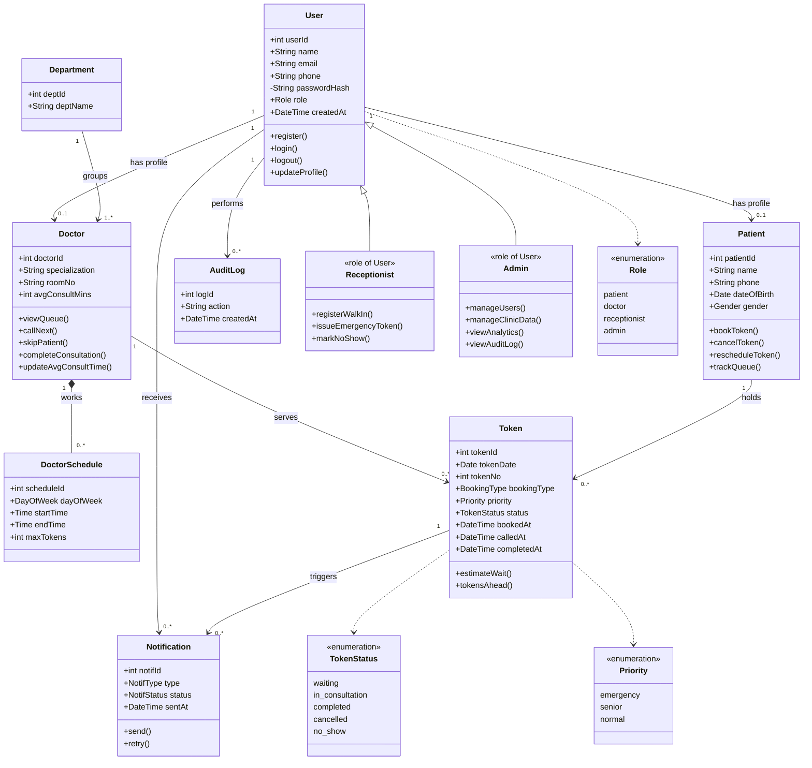

# MedQ - Clinic Queue & Live OPD Token System

A web application that replaces paper slips and shouting names in clinic waiting rooms. Patients book a token online, follow the queue live from their phone and get alerts when their turn is near. Doctors and receptionists manage the queue from one panel, and a public screen shows the current token.

Built as a semester project for the **Web Technologies** course on the **LAMP stack** (Linux, Apache, MySQL, PHP).

**Team:** Ahib Khurram and Abdullah Sadiq

---

## Table of Contents

1. [The Problem and Our Solution](#1-the-problem-and-our-solution)
2. [Technology Stack](#2-technology-stack)
3. [Database Design (ERD)](#3-database-design-erd)
4. [UML Class Diagram](#4-uml-class-diagram)
5. [Functional Requirements and Implementation](#5-functional-requirements-and-implementation)
6. [User Roles](#6-user-roles)
7. [Project Structure](#7-project-structure)
8. [How the Main Features Work](#8-how-the-main-features-work)
9. [Installation Guide](#9-installation-guide)
10. [Test Accounts](#10-test-accounts)
11. [Git Workflow](#11-git-workflow)

---

## 1. The Problem and Our Solution

**Problem.** In a busy clinic OPD, patients arrive early, sit in a crowded hall for two to four hours and have no idea when their turn will come. They keep asking an overwhelmed receptionist. Clinics manage queues on paper, emergency cases are squeezed in without a clear rule, no-shows go unnoticed and there is no data about peak hours or consultation times.

**Solution.** MedQ brings the queue to the patient:

- A patient books a token for a doctor online and follows the queue live, with an estimated waiting time.
- An alert is sent when only three tokens remain, so the patient can wait at home.
- A screen in the waiting room shows current and upcoming token numbers only, with no patient names.
- Doctors and receptionists call the next patient, skip no-shows, register walk-ins and issue emergency tokens from one panel.
- Emergency cases go through a priority queue instead of being squeezed in by hand.
- The admin manages clinic data and sees analytics and an audit log.

---

## 2. Technology Stack

| Layer | Technology |
|---|---|
| Operating system | Ubuntu Linux |
| Web server | Apache 2 |
| Database | MySQL (InnoDB) |
| Backend | PHP 8 with PDO (plain PHP, no framework) |
| Frontend | HTML, CSS, JavaScript (`fetch` / AJAX), Chart.js for admin charts |
| Version control | Git and GitHub (feature branches and pull requests) |

---

## 3. Database Design (ERD)

We used **Approach B (derived current state)**: the "current token" of a doctor is not stored in a column. It is found with a query on the `tokens` table:

```sql
SELECT token_no FROM tokens
 WHERE status = 'in_consultation' AND doctor_id = ? AND token_date = CURDATE() LIMIT 1;
```

This avoids keeping two copies of the same fact in sync.


### Tables

| Table | Purpose |
|---|---|
| `users` | Every account (patient, doctor, receptionist, admin) with a hashed password and a role |
| `patients` | Patient details. `user_id` is nullable because walk-in patients have no account |
| `departments` | Clinic departments (for example Cardiology) |
| `doctors` | Doctor profile linked to a user and a department, with room and average consultation time |
| `doctor_schedules` | Working days and times of each doctor, and the maximum tokens per day |
| `tokens` | One row per booked or issued token, with priority, status and timestamps |
| `notifications` | Alerts for patients (booked, 3 tokens away, your turn, cancelled) with a delivery status |
| `audit_log` | Who did what and when |

### Important database rules

- **No duplicate token numbers:** `UNIQUE (doctor_id, token_date, token_no)`.
- **Only one patient in consultation per doctor per day:** a unique key on a generated column (`uq_one_active`).
- **No overlapping schedules for the same doctor:** two triggers (insert and update). Different doctors may work at the same time.
- **Safe deletes:** foreign keys stop deleting a department that has doctors, or a doctor that has tokens.
- **Valid status values:** `waiting`, `in_consultation`, `completed`, `cancelled`, `no_show`.

---

## 4. UML Class Diagram

The diagram below shows the domain classes, their attributes, their main operations and their relationships. It renders automatically on GitHub.



---

## 5. Functional Requirements and Implementation

| ID | Requirement | How we implemented it | Main files |
|---|---|---|---|
| FR-1 | User accounts: register, log in, manage profile | Patients register (a `users` row and a `patients` row are created together), log in with a session and edit their profile (name, phone, date of birth, gender) | `register.php`, `login.php`, `logout.php`, `patient/profile.php` |
| FR-2 | Search doctors by department or name and view schedules | Search form with name and department filters. Each doctor's schedule is shown as text such as "Mon 09:00-13:00" | `patient/doctors.php` |
| FR-3 | Token booking, system assigns the next serial number | Patient picks a doctor and a date. The next number is the highest number of that doctor and day plus one | `patient/book.php`, `includes/patient.php` |
| FR-4 | Cancel or reschedule a booked token | Cancel works only for the patient's own waiting token. Reschedule books the new date first and cancels the old token only if that succeeded | `patient/my_tokens.php`, `patient/reschedule.php` |
| FR-5 | Live queue tracking: status, current token, estimated wait | Token status page shows "now serving", patients ahead and estimated wait, and refreshes every 10 seconds | `patient/token_status.php` |
| FR-6 | Alerts for booking, "3 tokens away", "your turn" and cancellation | Every alert is saved in the `notifications` table, then "sent". Sending is simulated by writing to a log file (email works if enabled). A script retries failed alerts. Patients see their alerts on a page | `includes/notify.php`, `patient/alerts.php`, `scripts/retry_notifications.php` |
| FR-7 | Doctor queue control: view queue, call next, skip, complete | Doctor panel with the day's queue and buttons. A doctor can only see and change his own queue | `doctor/dashboard.php`, `includes/queue.php` |
| FR-8 | Average consultation time updated automatically | After every completed visit, the average of the doctor's last 20 consultations (called to completed) is saved in `doctors.avg_consult_mins` | `includes/queue.php` (`update_avg_consult`) |
| FR-9 | Receptionist registers walk-in patients and issues tokens | Walk-in form creates a patient without an account (or reuses one with the same phone) and issues a token for today | `receptionist/walkin.php` |
| FR-10 | Emergency tokens inserted ahead of normal ones | Priority "emergency" is served before "senior" and "normal". An emergency token may exceed the daily limit | `receptionist/walkin.php`, `includes/patient.php` |
| FR-11 | No-show handling | Receptionist marks no-shows or cancels waiting tokens. The queue updates immediately | `receptionist/dashboard.php` |
| FR-12 | Admin manages users, departments, doctors and schedules | Full CRUD pages for the four tables with validation and friendly error messages | `admin/users.php`, `admin/departments.php`, `admin/doctors.php`, `admin/schedules.php` and their `*_form.php` files |
| FR-13 | Analytics (peak hours, no-show rate, average wait per doctor) and audit log | Analytics page with tables and bars for 7, 30 or 90 days, live charts on the admin dashboard, and an audit log page with filters and paging | `admin/analytics.php`, `admin/dashboard.php`, `admin/chart_data.php`, `js/admin_charts.js`, `admin/audit_log.php` |
| FR-14 | Unique serial token per doctor per day and daily limit | Number assigned inside a transaction that locks the doctor row. Daily limit comes from the schedule's `max_tokens` | `includes/patient.php` (`issue_token`) |
| FR-15 | Queue ordered by priority, then token number | `ORDER BY FIELD(priority,'emergency','senior','normal'), token_no` is used everywhere the queue is read | `includes/queue.php`, `patient/token_status.php` |
| FR-16 | ETA = tokens ahead x rolling average consultation time | Patients ahead are counted with the same ordering rule and multiplied by the doctor's average time | `patient/token_status.php` |
| FR-17 | Public display board with current token, next tokens and average time | Stand-alone page that asks `board_data.php` for JSON every 2 seconds. Only token numbers are sent, never names | `board.php`, `board_data.php` |
| FR-18 | "3 away" alert triggered when the current token changes | When a doctor calls the next patient, the 3rd waiting patient is alerted (once) | `includes/notify.php` (`check_near_turn`), `includes/queue.php` |
| FR-19 | Role-based access | The role is stored in the session at login. `require_role()` at the top of every page returns 403 for other roles. Each role has its own folder and dashboard | `includes/auth.php`, `dashboard.php` |

---

## 6. User Roles

| Role | Can do |
|---|---|
| **Patient** | Register, log in, edit profile, search doctors, book / cancel / reschedule tokens, track the live queue, read alerts |
| **Doctor** | See today's queue, call the next patient, complete a consultation, skip a patient |
| **Receptionist** | See any doctor's queue, register walk-ins, issue emergency tokens, mark no-shows, cancel tokens |
| **Admin** | Manage users, departments, doctors and schedules, view dashboard charts, analytics and the audit log |
| **Public (no login)** | Home page and the live display board |

---

## 7. Project Structure

```
medq/
├── README.md
├── .gitignore
├── database/
│   ├── schema.sql            # all tables, constraints and triggers
│   ├── seed.sql              # sample data
│   ├── test_queries.sql      # queries used to check the design
│   └── reset.sh              # rebuilds the database (see warning in section 9)
├── docs/
│   └── erd-approach-b.png    # ERD image
└── backend/
    ├── index.php  login.php  register.php  logout.php  dashboard.php
    ├── board.php             # public display board (AJAX)
    ├── board_data.php        # JSON for the board
    ├── config/
    │   └── config.example.php
    ├── includes/
    │   ├── db.php            # PDO connection
    │   ├── functions.php     # session, e(), redirect(), flash messages
    │   ├── auth.php          # require_login(), require_role()
    │   ├── patient.php       # issue_token() and patient helpers
    │   ├── queue.php         # call next, complete, no-show, average time, audit helper
    │   ├── notify.php        # alerts
    │   ├── header.php  footer.php
    ├── css/style.css
    ├── js/admin_charts.js    # dashboard charts
    ├── admin/                # dashboard, CRUD pages, analytics, audit log, chart data
    ├── doctor/               # doctor panel
    ├── receptionist/         # queue page and walk-in / emergency form
    ├── patient/              # search, booking, tokens, alerts, profile
    ├── scripts/
    │   └── retry_notifications.php
    └── storage/              # notifications.log is written here (ignored by Git)
```

---

## 8. How the Main Features Work

**Login and sessions.** The registration form saves `password_hash()` of the password. At login we check it with `password_verify()`, call `session_regenerate_id()` and store `user_id`, `name` and `role` in `$_SESSION`. Every protected page starts with `require_role(...)`.

**Booking a token** (`issue_token`). Check date and working day, check the patient has no active token for that doctor and day, start a transaction, lock the doctor row with `SELECT ... FOR UPDATE`, check the daily limit, compute `MAX(token_no) + 1`, insert the token, commit, then save a "booked" alert. Because of the lock, two simultaneous bookings never get the same number.

**Queue order.** Emergency, then senior, then normal, then by token number. MySQL's `FIELD()` turns the priority name into a number so it can be sorted.

**Calling the next patient.** In a transaction we make sure nobody is already in consultation, pick the first waiting token in queue order, set it to `in_consultation` with `called_at = NOW()`, and send "your turn" to that patient and "3 tokens away" to the 3rd waiting patient.

**Estimated wait.** Patients ahead of the token multiplied by the doctor's average consultation time. That average is recalculated every time a consultation is completed.

**Alerts.** Saved first as `pending`, then sent and marked `sent` or `failed`. Failed alerts can be retried with `php backend/scripts/retry_notifications.php`.

**Live updates.** Patient and doctor pages reload themselves with a meta refresh. The public board and the admin charts use JavaScript `fetch` to ask a PHP file for JSON and redraw without reloading the page.

---

## 9. Installation Guide

### Requirements

Ubuntu with Apache 2, MySQL, PHP 8 (with the `php-mysql` extension) and Git.

### Steps

```bash
# 1. Clone
git clone git@github.com:YOUR_USERNAME/medq.git
cd medq

# 2. Create the database and a database user
sudo mysql
```

```sql
CREATE DATABASE medq CHARACTER SET utf8mb4 COLLATE utf8mb4_unicode_ci;
CREATE USER 'medq_user'@'localhost' IDENTIFIED BY 'ChangeThisPassword123!';
GRANT ALL PRIVILEGES ON medq.* TO 'medq_user'@'localhost';
FLUSH PRIVILEGES;
EXIT;
```

```bash
# 3. If creating the triggers fails with error 1419, run this once, then repeat step 4
sudo mysql -e "SET GLOBAL log_bin_trust_function_creators = 1;"

# 4. Create the tables and sample data
mysql -u medq_user -p medq < database/schema.sql
mysql -u medq_user -p medq < database/seed.sql

# 5. Create your local config (it is ignored by Git) and enter your database password
cp backend/config/config.example.php backend/config/config.php
nano backend/config/config.php

# 6. Folder where alerts are logged
mkdir -p backend/storage
sudo chgrp www-data backend/storage && chmod 775 backend/storage

# 7. Serve the project with Apache
sudo ln -s "$(pwd)" /var/www/html/medq
chmod o+x ~ "$(pwd)"
sudo systemctl start apache2
```

### Give the sample users a real password

`seed.sql` stores a dummy value as password, so nobody can log in yet. Generate a hash and save it for all users (development only):

```bash
php -r "echo password_hash('Test@1234', PASSWORD_DEFAULT), PHP_EOL;"
```

```sql
-- in: mysql -u medq_user -p medq
UPDATE users SET password_hash = 'PASTE_THE_HASH_HERE';
```

Open **http://localhost/medq/backend/**.

> **Warning:** `database/reset.sh` rebuilds the database from `seed.sql`, which removes the real password hashes. Repeat the step above after using it.

### Seeing the system work

The seed data has doctor schedules on Mon, Tue, Wed and Thu only. To book for today, log in as admin and add a schedule for today's weekday (for example `00:00` to `23:59`) for Dr. Ayesha.

---

## 10. Test Accounts

After the password step above, every sample account uses the password `Test@1234`.

| Role | Email |
|---|---|
| Admin | admin@medq.test |
| Receptionist | desk@medq.test |
| Doctor | ayesha@medq.test |
| Doctor | bilal@medq.test |
| Patient | ali@medq.test |
| Patient | sara@medq.test |

The public board is at `/medq/backend/board.php` and needs no login.

---

## 11. Git Workflow

We worked with feature branches and pull requests. Nobody committed straight to `main`, and each pull request was reviewed by the other team member before merging.

- Branch names: `feature/...`, `chore/...`, `docs/...`
- Commit messages: `feat:`, `fix:`, `chore:`, `docs:` followed by a short description
- Secrets (`config.php`, `.env`) and logs are listed in `.gitignore`

| Area | Branch |
|---|---|
| Authentication (register, login, logout) | `feature/authentication` |
| Authorization and admin dashboard | `feature/authorization-admin-dashboard` |
| Admin menu | `chore/admin-menu` |
| CRUD: users and departments | `feature/crud-users-departments` |
| CRUD: doctors and schedules | `feature/crud-doctors-schedules` |
| Patient foundation (time zone, helpers) | `chore/patient-foundation` |
| Patient: search and booking | `feature/patient-search-booking` |
| Patient: my tokens, live status, reschedule | `feature/patient-my-tokens` |
| Staff foundation (queue helpers) | `chore/staff-foundation` |
| Receptionist panel | `feature/receptionist-panel` |
| Doctor panel | `feature/doctor-panel` |
| Notifications core | `chore/notifications-core` |
| Patient alerts | `feature/patient-alerts` |
| Public display board | `feature/public-board` |
| Admin analytics | `feature/admin-analytics` |
| Audit log and logging of admin actions | `feature/admin-audit-log` |
| Admin dashboard charts | `feature/admin-charts` |
| Patient profile | `feature/patient-profile` |
| Documentation | `docs/readme` |

---

